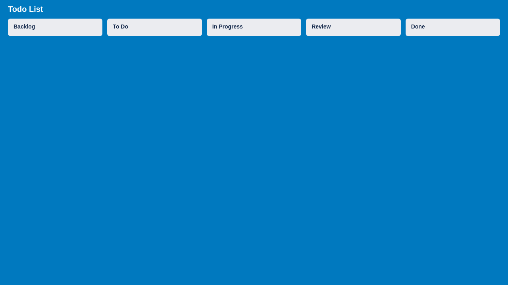
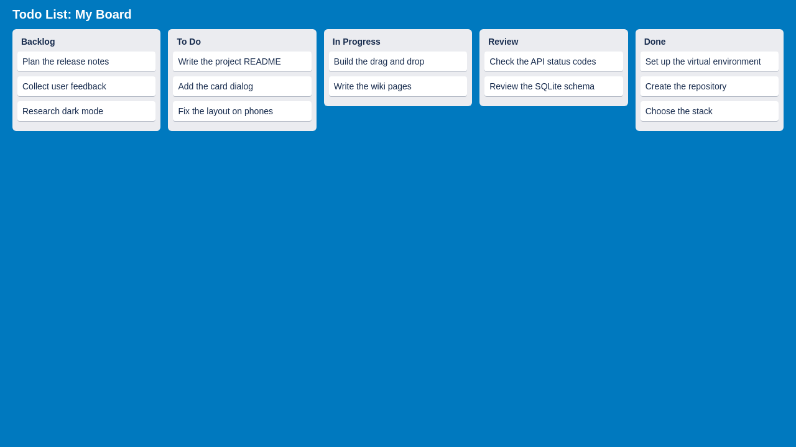
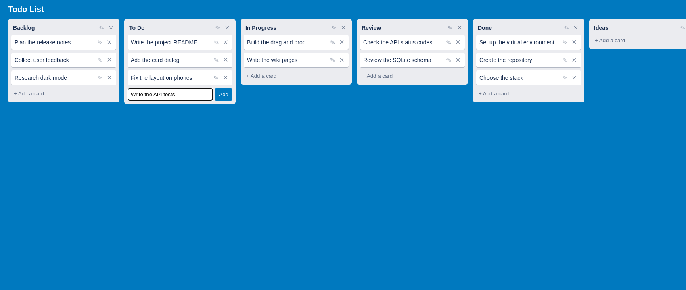
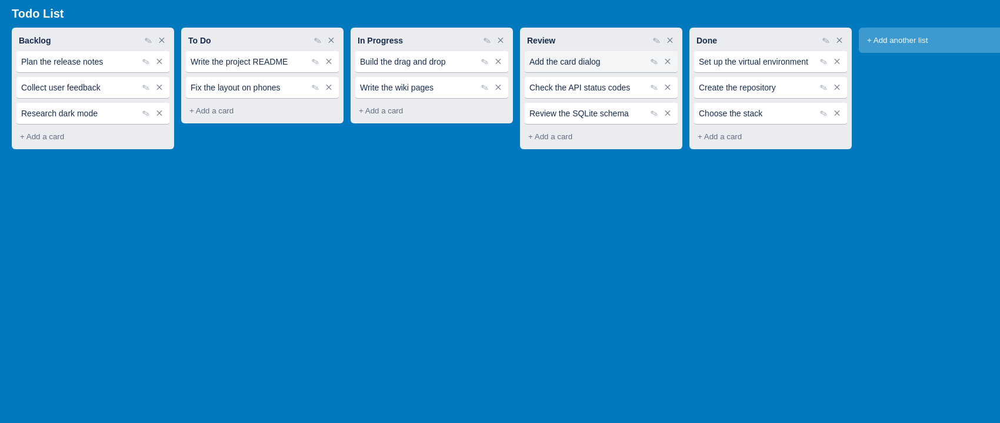
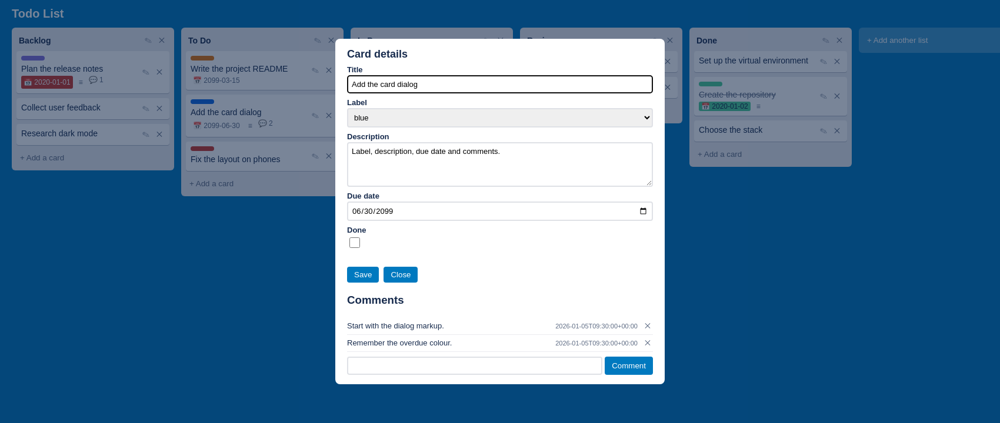
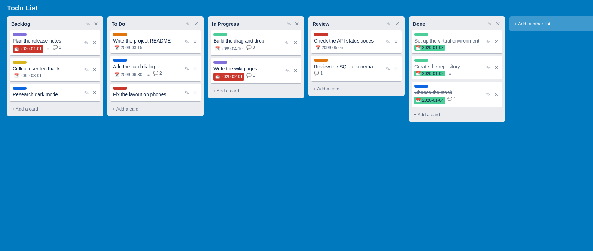

# 🚀 Todo List

A Trello-style Kanban todo list built with the Python standard library, SQLite and plain JavaScript, with no runtime dependencies. It is Day 89 of the 100 Days of Code bootcamp, for course participants who want to compare solutions and for visitors who look for ideas.

## 📚 Table of Contents

- [Overview](#-overview)
- [Requirements](#-requirements)
- [Setup](#-setup)
- [Run](#-run)
- [Screenshots](#-screenshots)
- [Tests](#-tests)
- [Reflection](#-reflection)
- [License](#-license)
- [Links](#-links)
- [Appendix: Project documents](#-appendix-project-documents)

## 🧭 Overview

The board has five lists (Backlog, To Do, In Progress, Review, Done) that hold cards. The project is built in six steps, and each step has a screenshot below and a wiki page in English, Danish and Bahasa Malaysia that explains what it taught.

| Folder | What it is for |
| --- | --- |
| `src/todo_list/` | The program: `domain`, `application`, `infrastructure` and `presentation` layers; `constants.py` holds every constant |
| `tests/` | `unit`, `integration` and `e2e` tests, run with pytest |
| `docs/` | Project documents, wiki pages (`docs/wiki/`) and screenshots (`docs/screenshots/`) |
| `tools/screenshots/` | The Docker container that opens the app in a headless browser and takes the screenshots |
| `scripts/` | Helper scripts, such as the opengrep scan |

## 📋 Requirements

- Python 3.13 or newer, to run the program. The program has no runtime dependencies.
- `pip` and `venv`, which come with Python, to create the local environment.
- pytest, pytest-cov, ruff and mypy for development; they are installed by the `dev` group below.
- Docker, only to take screenshots and run the browser tests.
- Doxygen, only to build the source documentation.
- opengrep, only to scan the code before a push.

## 🛠️ Setup

Create a local virtual environment named `.venv` in the repository root, then upgrade pip.

```powershell
python -m venv .venv
.\.venv\Scripts\Activate.ps1
python -m pip install --upgrade pip
python -m pip install -e ".[dev]"
```

On Linux or macOS the commands are:

```bash
python3 -m venv .venv
source .venv/bin/activate
python -m pip install --upgrade pip
python -m pip install -e ".[dev]"
```

To leave the environment, run `deactivate`. The folder `.venv/` is ignored by git.

## ▶️ Run

With the environment active:

```powershell
python -m todo_list
```

Then open <http://127.0.0.1:8000/> in a browser. Stop the server with `Ctrl+C`. The host and port are in `src/todo_list/constants.py`.

The page uses a JSON API under `/api/` (board, lists, cards, card details and comments); the routes are listed in the wiki, steps 3 to 5.

## 📸 Screenshots

| Step | What it shows |
| --- | --- |
| 1. Project foundation | The first page with the five empty lists  |
| 2. Domain and storage | The board read from SQLite with sample cards  |
| 3. JSON API and editing | A new list and a card form, added through the page  |
| 4. Kanban board and drag and drop | A card dragged from To Do to Review  |
| 5. Card details | The card detail dialog  |
| 6. Wrap-up and reflection | The finished board  |

Screenshots are made in a Docker container, never on the desktop:

```powershell
docker build -t todo-list-shots tools/screenshots
docker run --rm -v "${PWD}:/work" todo-list-shots step-01
```

## 🧪 Tests

```powershell
python -m pytest
python -m ruff check src tests
python -m mypy src tests
python scripts/run_opengrep.py
doxygen Doxyfile
```

`pytest` also prints the coverage and fails below 90 percent. Run the opengrep scan before every push.

The browser tests in `tests/e2e/` run only in the Docker container, never on the desktop. They write their result to `results/e2e.xml`:

```powershell
docker build -t todo-list-shots tools/screenshots
docker run --rm -v "${PWD}:/work" -w /work --entrypoint python todo-list-shots -m pytest -o addopts="" -o pythonpath="src tests" --junitxml=results/e2e.xml tests/e2e
```

## 💭 Reflection

- **Approach.** Plan first, then six small steps; each step is one branch, one review and one pull request, with a screenshot and a wiki page.
- **Easy.** The domain rules and SQLite: the layers keep the rules free of HTTP and SQL, so most tests run in milliseconds.
- **Hard.** Drag and drop (the drop position comes from the pointer, and the test needs a real browser) and due dates (a forgiving parser accepts shapes you do not want).
- **Biggest learning.** A framework is a choice with a cost. The standard library was enough, so there are no runtime dependencies and every layer is visible.
- **Differently next time.** Start the browser tests earlier and settle the stack before the first milestone.

The longer version is in the wiki, step 6.

## 📄 License

GNU Affero General Public License v3.0, see [LICENSE](./LICENSE).

## 🔗 Links

- [Repository][repository]
- [Documentation][documentation]
- [Issue tracker][issues]

## 📎 Appendix: Project documents

| Document | What it tells you |
| --- | --- |
| [Business Case][BC-001] | Why the project exists, its scope and success criteria |
| [Stakeholder Analysis][SA-001] | Who is involved; the stakeholder IDs used for owners and reviewers |
| [Project Plan][PP-001] | The gateways and their schedule |
| [Milestones][milestones] | One document per gateway: Go/No-Go criteria and tasks |
| [Artifact registry][registry] | Where each artifact type lives, the next version, the PO language and domain |
| [Traceability matrix][TM-001] | How the artifacts link and when each was last reviewed |
| [Framework README][framework-readme] | The framework this project uses |
| [Framework changelog][framework-changelog] | What changed in each framework release |

---

[repository]: https://git.tirsystem.com/Tirsvad-Udemy-100-days-of-code/089-assignment-todo-list
[documentation]: https://git.tirsystem.com/Tirsvad-Udemy-100-days-of-code/089-assignment-todo-list/wiki
[issues]: https://git.tirsystem.com/Tirsvad-Udemy-100-days-of-code/089-assignment-todo-list/issues
[BC-001]: ./docs/business-case.md
[SA-001]: ./docs/stakeholder-analysis.md
[PP-001]: ./docs/project-plan.md
[milestones]: ./docs/milestones/
[registry]: ./docs/artifact-registry.md
[TM-001]: ./docs/sqa/traceability-matrix.md
[framework-readme]: ./framework/README.md
[framework-changelog]: ./framework/CHANGELOG.md
